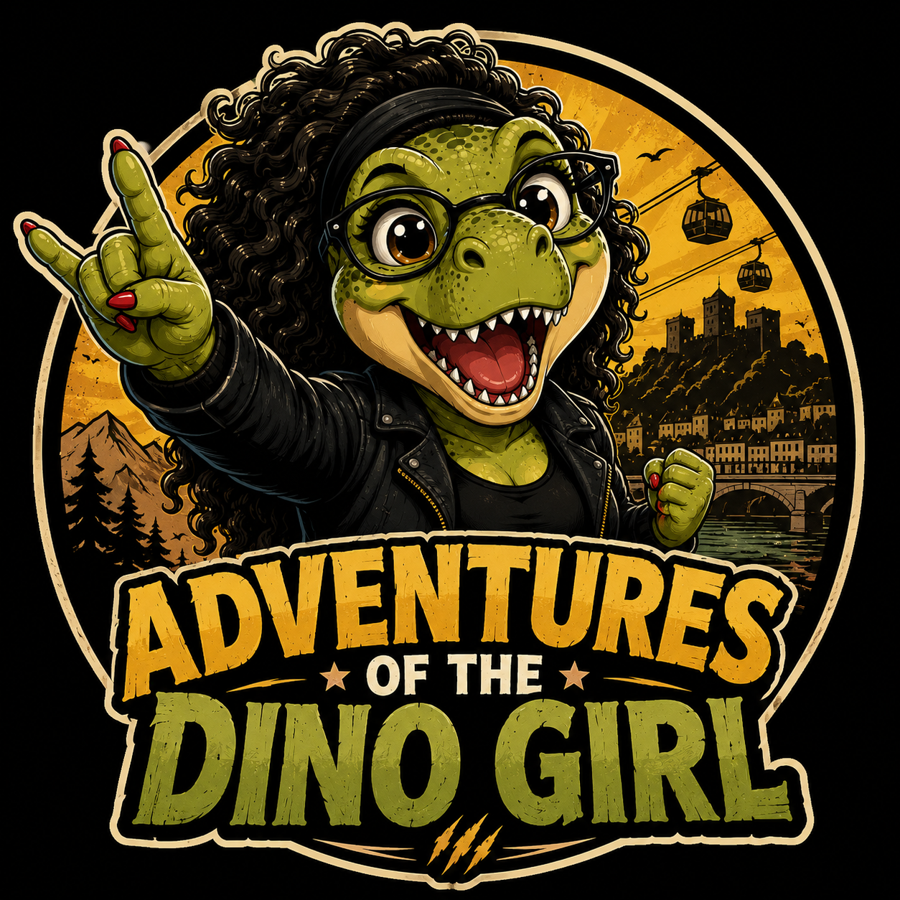
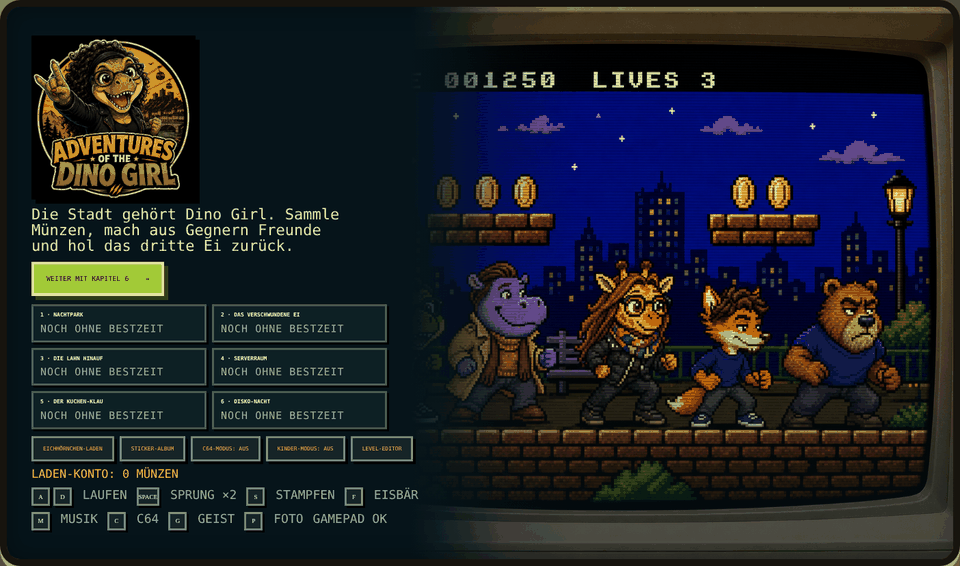
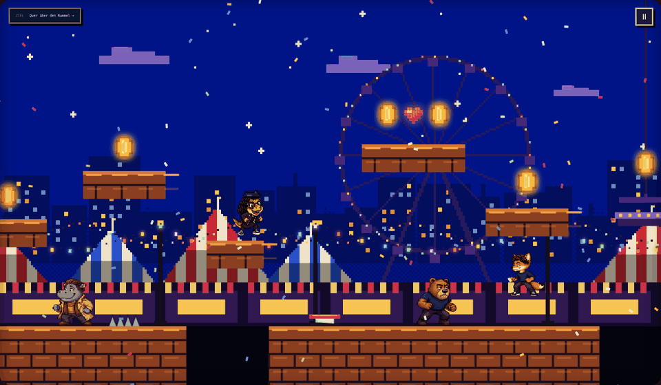
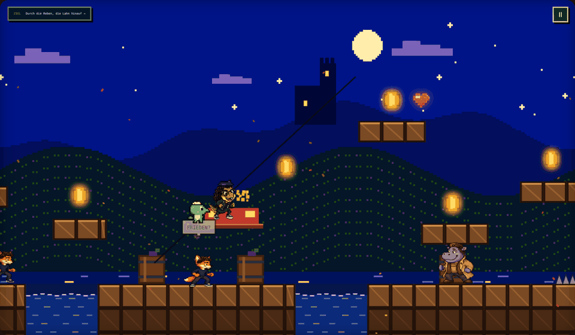
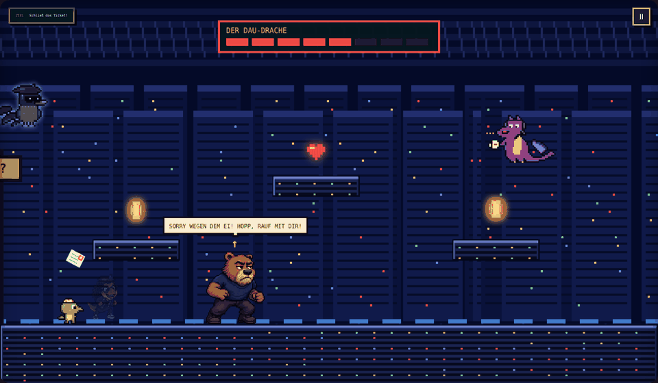
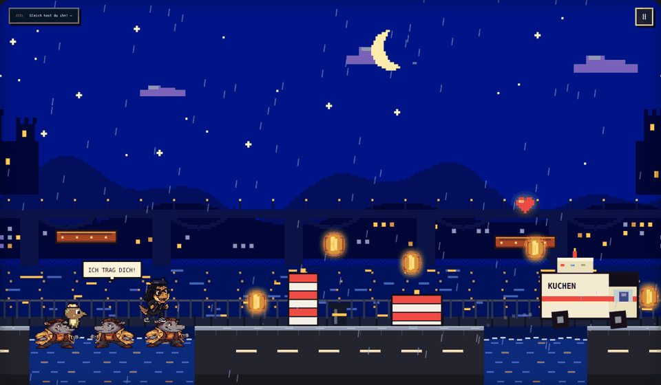
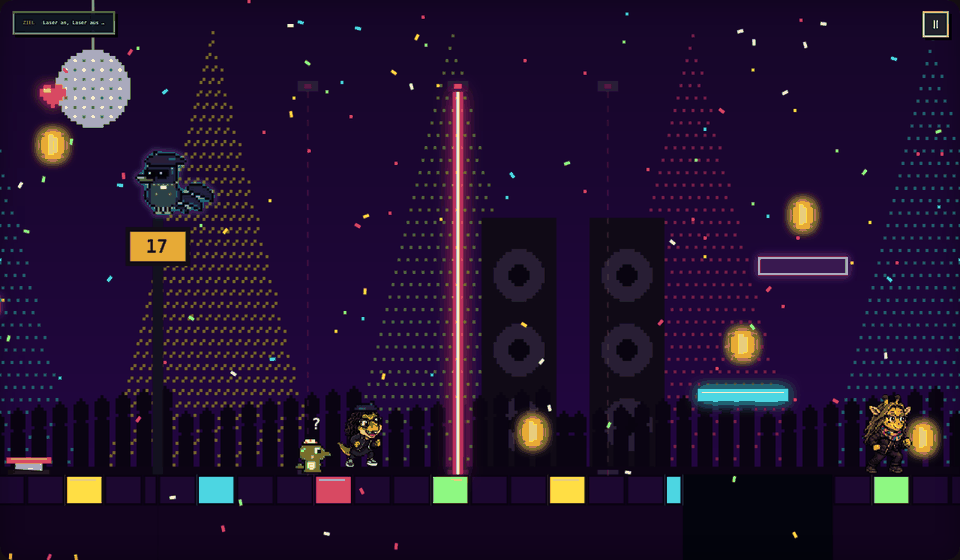
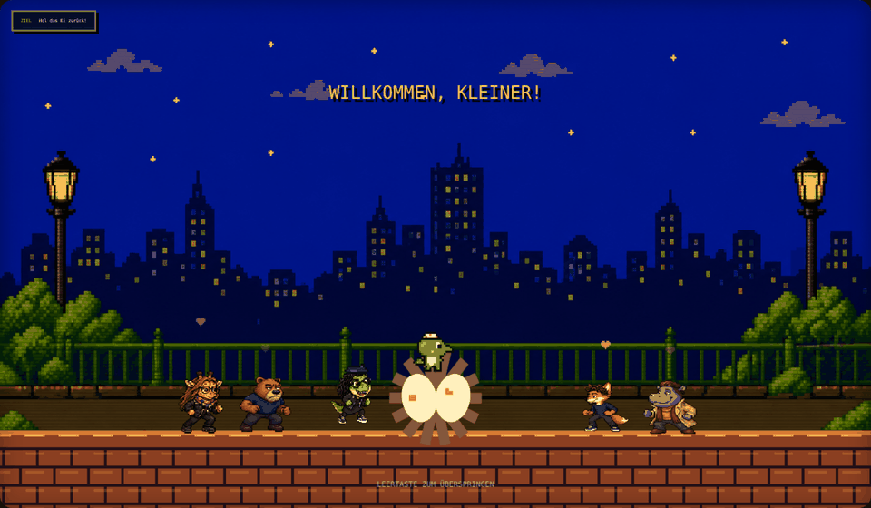
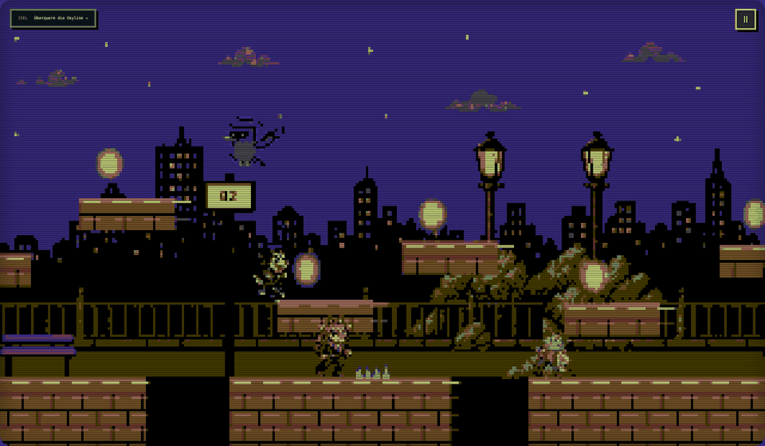
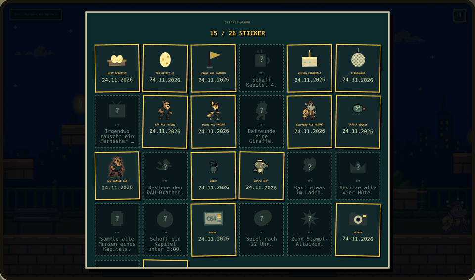

<p align="center">
  
</p>

<h1 align="center">Adventures of the Dino Girl</h1>

<p align="center">
  Ein Jump'n'Run im 8-Bit-Stil über eine Nachtstadt am Fluss.<br>
  Sechs Kapitel, ein Kolkrabe mit Baskenmütze, ein geklautes Ei, ein geklauter Kuchen.<br>
  Und Gegner, aus denen man Freunde macht.
</p>

<p align="center">
  
</p>

---

## Worum es geht

Dino Girl rettet ihr Nest im Nachtpark und stellt fest: Da fehlt ein Ei. Die Spur führt ans Rheinufer, über die Kirmes und auf eine Baustelle, wo der große Bär das Ei über dem Kopf hält. Danach schlüpft ein Baby-Dino, der von da an hinterherläuft. Es geht die Lahn hinauf bis Burg Lahneck, in einen Serverraum zum DAU-Drachen, hinter einem Kuchen-Lieferwagen her über die B42 und am Ende in eine Disko, in der der Kolkrabe auflegt.

Gegner werden nicht besiegt, sondern befreundet. Wer einmal Freund war, hilft später mit.

## Spielen

1. Unter [Releases](../../releases) die neueste `DinoGirl-*.zip` laden und entpacken.
2. `index.html` im Browser öffnen. Fertig, ein Server ist nicht nötig.

Wer lieber über einen lokalen Server spielt: `python server.py` starten und `http://localhost:8000` öffnen.

Der Spielstand (freigeschaltete Kapitel, Laden-Konto, Bestzeiten, Sticker) wird im Browser gespeichert. Zum Ausprobieren schaltet `index.html#kapitel-6` alle Kapitel frei.

## Steuerung

| Aktion | Tastatur | Gamepad | Touch |
|---|---|---|---|
| Laufen | `A` `D` oder `←` `→` | Stick, Steuerkreuz | `←` `→` |
| Springen, in der Luft nochmal: Double Jump | `Leertaste`, `W`, `↑` | A | `↑` |
| Stampf-Attacke (in der Luft) | `S`, `↓` | Stick nach unten | `↓` |
| Stofftier-Eisbär werfen | `F`, `X` | X / B | `BÄR` |
| In einen Rausch-Fernseher steigen | `S` davor | | |
| Pause | `Esc` | Start | `Ⅱ` |
| Fotomodus | `P` | | im Pausenmenü |
| Musik · C64-Modus · Geisterläufer | `M` · `C` · `G` | | |

## Die Kapitel

| | Kapitel | Zonen | Besonderes |
|---|---|---|---|
| 1 | **Nachtpark** | Nachtpark, Dächerweg, Altstadt | Irgendwo rauscht ein Fernseher … |
| 2 | **Das verschwundene Ei** | Rheinufer, Kirmes, Baustelle | Boote, Trampoline, Kranlasten, Boss: der große Bär |
| 3 | **Die Lahn hinauf** | Weinberge, Kneipenviertel, Burg Lahneck | Seilbahn, der Baby-Dino läuft mit |
| 4 | **Serverraum** | Rechenzentrum, Kühlgang, Kabelsalat | Lüfter-Aufwind, Bugs vermehren sich, Boss: der DAU-Drache |
| 5 | **Der Kuchen-Klau** | B42, Tunnel, Brücke | Verfolgungsjagd, der Bildschirm scrollt von selbst |
| 6 | **Disko-Nacht** | Tanzfläche, Lasergang, DJ-Pult | Plattformen und Laser schalten im Takt der Musik |
| ★ | **Rauschen** | Geheimlevel | Ganz ruhig, Berlin School und Glühwürmchen |

<table>
  <tr>
    <td></td>
    <td></td>
  </tr>
  <tr>
    <td align="center"><sub>Kapitel 2 · Kirmes</sub></td>
    <td align="center"><sub>Kapitel 3 · Weinberge mit Seilbahn und Baby-Dino</sub></td>
  </tr>
  <tr>
    <td></td>
    <td></td>
  </tr>
  <tr>
    <td align="center"><sub>Kapitel 4 · Der große Bär hilft gegen den DAU-Drachen</sub></td>
    <td align="center"><sub>Kapitel 5 · Hinter dem Kuchen her, Nilpferde als Brücke</sub></td>
  </tr>
  <tr>
    <td></td>
    <td></td>
  </tr>
  <tr>
    <td align="center"><sub>Kapitel 6 · Laser im Takt</sub></td>
    <td align="center"><sub>Willkommen, Kleiner!</sub></td>
  </tr>
</table>

## Was sonst noch drin ist

**Freunde statt Feinde.** Getroffene Gegner setzen sich hin, sagen „SORRY!“ und schicken Herzchen. Jede Tierart hat ihren eigenen Kopf: Der Fuchs hüpft, die Giraffe bemerkt dich und sprintet los, das Nilpferd rollt sich ein und ist danach schwindelig, der Bär hält zwei Treffer aus.

**Freunde helfen mit.** Wer eine Art schon einmal befreundet hat, bekommt später Hilfe: Der Fuchs zeigt versteckte Münzen, Nilpferde bilden eine Brücke, die Giraffe reicht ein Herz herunter, der Bär macht Räuberleiter. Im Drachenkampf kommt sogar der große Bär aus Kapitel 2 vorbei.

**Der Kolkrabe of Doom** landet an jedem Checkpoint auf dem Zonenschild und kommentiert, was du in der Zone davor angestellt hast. „ZWEIMAL INS WASSER. RESPEKT.“

**Eichhörnchen-Laden.** Münzen landen auf einem Konto. Das Eichhörnchen verkauft Doppelwurf, Bumerang-Bär, ein Extra-Herz und vier Hüte. Kroketten hat es leider keine.

**Wetter** pro Zone: Regen mit Pfützenglanz, Herbstlaub, Schnee, Funkenflug, Konfetti, Glühwürmchen.

**Soundtrack.** 18 Chiptune-Stücke auf einem eigenen WebAudio-Sequencer, ganz ohne Audiodateien. Arpeggios im Berlin-School-Geist, Humtata auf der Kirmes, Polka im Kneipenviertel, Warteschleifenmusik beim DAU-Drachen.

**Zeitrennen.** Zeit im HUD, Bestzeit und Highscore pro Kapitel, die beste Runde läuft als Geist mit.

**Nachtschicht.** Zwischen 22 und 5 Uhr wird alles dunkler, Laternen und Fackeln leuchten stärker, und der Rabe ist müde.

**Kinder-Modus.** Zwei Herzen mehr, langsamere Gegner, schwächere Bosse. Ein Sturz in den Abgrund kostet nichts („PLOPP! NOCHMAL.“), und die Disko-Plattformen bleiben stehen.

<table>
  <tr>
    <td></td>
    <td></td>
  </tr>
  <tr>
    <td align="center"><sub>C64-Modus: 16 Farben, Scanlines, SID-Klang</sub></td>
    <td align="center"><sub>Sticker-Album mit 26 Stickern</sub></td>
  </tr>
</table>

**C64-Modus.** Echte 16-Farben-Palette, dicke Pixel, Scanlines, SID-artiger Klang und ein Ladebildschirm mit `LOAD"DINO",8,1`.

**Fotomodus.** Spiel anhalten, Kamera verschieben, Filter (Sepia, Noir, Nacht, C64) und Rahmen (CRT, Polaroid) wählen, als PNG speichern.

**Sticker-Album.** 26 Sticker für Kapitel, Freundschaften, Bosse, Geheimnisse und ein paar Albernheiten.

## Level-Editor

`editor.html` öffnen. Ein Kapitel als Vorlage laden oder leer anfangen, Boden, Plattformen, Münzen, Gegner, Trampoline, bewegte Plattformen und Aufwinde setzen. Mit dem Zeiger verschieben, Plattformen am rechten Rand breiter ziehen. Rechts lassen sich Zonen mit Hintergrund, Musik, Material und Wasser oder Abgrund einstellen.

**TESTSPIELEN** startet das Level sofort im Spiel, danach steht es im Menü als „Eigenes Level“. **EXPORT** liefert JSON, das sich als neues Kapitel in `js/levels.js` eintragen lässt.

## Projektaufbau

```
index.html, style.css     das Spiel
editor.html               der Level-Editor
js/levels.js              alle Level als Daten, hier entstehen neue Kapitel
js/jump.js                die Engine: Physik, Figuren, Bosse, Menüs
js/music.js               Chiptune-Sequencer und alle Stücke
js/assets.js              eingebettete Spielgrafiken (automatisch erzeugt)
js/editor.js              Logik des Editors
img/                      Grafiken
tools/                    Python-Skripte, die Pixelgrafiken erzeugen
public/, app/, worker/    Fassung für das Web-Hosting
source-assets/            ursprüngliche Referenz- und Spritegrafiken
```

Das Spiel selbst ist reines JavaScript mit Canvas und WebAudio, ohne Bibliotheken und ohne Build-Schritt.

## Grafiken neu erzeugen

Die meisten Pixelgrafiken entstehen per Skript (Python mit Pillow):

```
python tools/make_backdrops.py   # alle Hintergründe ab Kapitel 2
python tools/make_kolkrabe.py    # der Kolkrabe of Doom
python tools/make_sprites.py     # Baby-Dino, Eichhörnchen, Bug, DAU-Drache
python tools/make_assets.py      # bettet alles in js/assets.js ein (danach immer ausführen)
```

Durch das Einbetten bleiben C64-Modus und Fotomodus auch dann funktionsfähig, wenn `index.html` direkt aus dem Ordner geöffnet wird.

## Mitwirkende

Figuren, Welt und Idee: [kolkrabeofdoom](https://github.com/kolkrabeofdoom). Kapitel 2 bis 6, Engine, Musik und Pixelgrafiken sind gemeinsam mit Claude entstanden.
